# 🛡️ Práctica #3 — Infraestructura #2: VPN IPsec, Jump Server y RemoteApp con FortiGate

> **Video de demostración:** [🎥 Ver video](https://youtu.be/-BmUhfW7bdo)

**Asignatura:** Seguridad de Redes  
**Estudiante:** Luis Ariel Alevante Agramonte  
**Matrícula:** 2025-2174

---

## 1. Objetivo

Implementar en GNS3 una infraestructura con **FortiGate**, un dispositivo Cisco, direccionamiento segmentado mediante VLANs, una **VPN IPsec Remote Access** y un **Jump Server Windows** que centraliza el acceso a los servicios administrativos del Web Server.

La práctica demuestra que:

- `VLAN10-USERS` funciona como red `/25` con dos clientes por DHCP.
- `JUMP-SERVER-2174` reside en una LAN `/29` independiente (`VLAN20-JUMP`).
- `WEB-SV-2174` reside en otra LAN `/29` independiente (`VLAN30-WEB`).
- La VPN `VPN-REMOTE-2174` permite llegar al **Jump Server**, pero bloquea el acceso directo al Web Server.
- Desde el Jump Server solo se permiten **HTTPS, RDP y SSH** hacia `WEB-SV-2174`.
- `USER-SIN-PRIV` recibe únicamente el recurso Web publicado.
- `USER-PRIV` recibe Web, PuTTY y Remote Desktop Connection.
- Se configuraron **RD Web Access clásico** y **Remote Desktop Web Client HTML5**.
- Los puertos no utilizados del switch se colocan en **VLAN 999 y shutdown**.
- `ISP-2174` brinda salida hacia GNS3 NAT mediante **PAT**.

---

## 2. Topología final

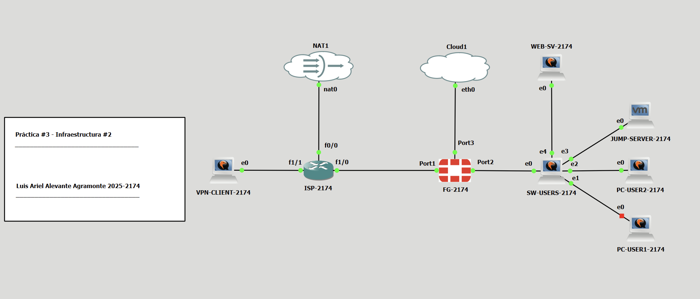

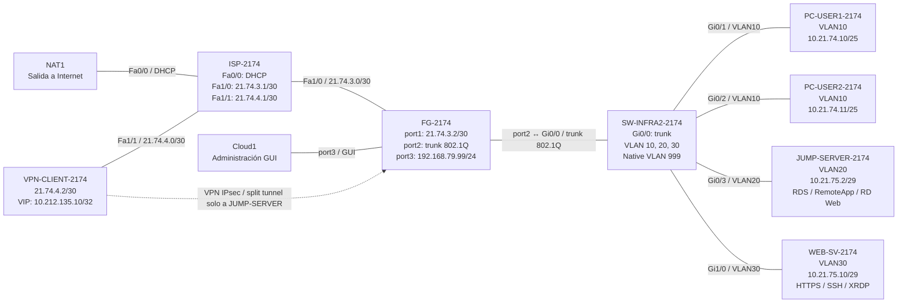

---

## 3. Plan de direccionamiento

| Equipo / segmento | Dirección |
|---|---|
| ISP Fa0/0 → NAT1 | DHCP (`192.168.136.129` observado) |
| ISP Fa1/0 → FortiGate | `21.74.3.1/30` |
| FortiGate port1 | `21.74.3.2/30` |
| ISP Fa1/1 → VPN Client | `21.74.4.1/30` |
| VPN-CLIENT-2174 | `21.74.4.2/30` |
| VLAN10-USERS | `10.21.74.0/25`, GW `10.21.74.1` |
| PC-USER1-2174 | `10.21.74.10/25` |
| PC-USER2-2174 | `10.21.74.11/25` |
| VLAN20-JUMP | `10.21.75.0/29`, GW `10.21.75.1` |
| JUMP-SERVER-2174 | `10.21.75.2/29` |
| VLAN30-WEB | `10.21.75.8/29`, GW `10.21.75.9` |
| WEB-SV-2174 | `10.21.75.10/29` |
| VPN pool | `10.212.135.10 - 10.212.135.20` |
| VPN VIP observada | `10.212.135.10/32` |
| FortiGate port3 / GUI | `192.168.79.99/24` |

Más detalle: [`docs/direccionamiento.md`](docs/direccionamiento.md)

---

## 4. Componentes

- GNS3 + GNS3 VM sobre VMware
- FortiGate VM64-KVM / FortiOS 7.0.9
- Cisco IOS Router como `ISP-2174`
- Cisco IOSvL2 como `SW-INFRA2-2174`
- Windows Server como `JUMP-SERVER-2174`
- Ubuntu como `WEB-SV-2174`, `PC-USER1-2174`, `PC-USER2-2174` y `VPN-CLIENT-2174`
- strongSwan como cliente IPsec
- Remote Desktop Services / RemoteApp / RD Web Access
- Remote Desktop Web Client HTML5
- PuTTY
- Apache2 / HTTPS, OpenSSH y XRDP en el Web Server

---

## 5. Configuración implementada

### 5.1 VLANs, DHCP y switch

El enlace `Gi0/0` de `SW-INFRA2-2174` funciona como trunk 802.1Q hacia el FortiGate y transporta las VLAN `10,20,30`, utilizando VLAN 999 como native VLAN.

| Puerto | Uso | VLAN |
|---|---|---:|
| Gi0/0 | Trunk hacia FortiGate | trunk 10,20,30 / native 999 |
| Gi0/1 | USER1 | 10 |
| Gi0/2 | USER2 | 10 |
| Gi0/3 | JUMP-SERVER | 20 |
| Gi1/0 | WEB-SERVER | 30 |
| Gi1/1–Gi1/3 | Puertos no utilizados | 999 + shutdown |

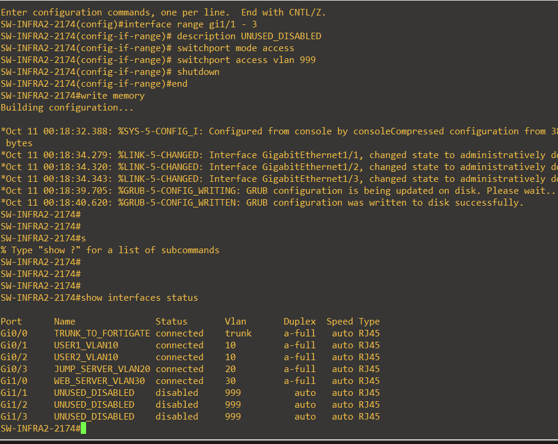

VLAN10 recibe DHCP desde FortiGate con pool `10.21.74.10–10.21.74.100` y reservas para USER1 (`.10`) y USER2 (`.11`).

### 5.2 FortiGate y objetos

Las interfaces principales son:

- `WAN-ISP (port1)` → `21.74.3.2/30`
- `VLAN10-USERS` → `10.21.74.1/25`
- `VLAN20-JUMP` → `10.21.75.1/29`
- `VLAN30-WEB` → `10.21.75.9/29`
- `port3` → `192.168.79.99/24` para administración GUI

Objetos principales:

- `USER-SIN-PRIV` → `10.21.74.10/32`
- `USER-PRIV` → `10.21.74.11/32`
- `JUMP-SERVER` → `10.21.75.2/32`
- `WEB-SERVER` → `10.21.75.10/32`
- `VPN-REMOTE-2174_range` → `10.212.135.10–10.212.135.20`

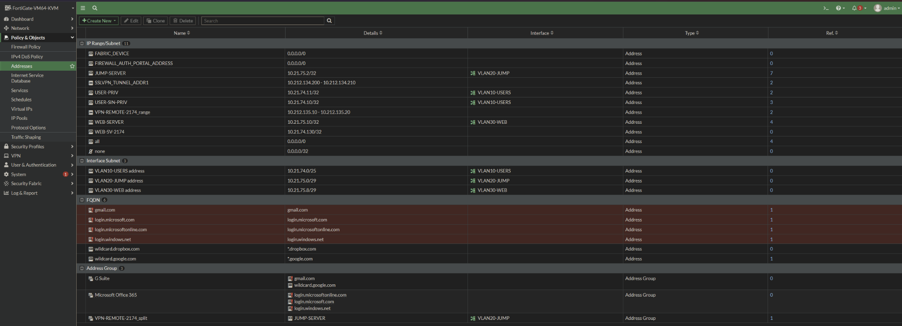

### 5.3 Políticas de seguridad

| Política | Flujo | Servicio | Acción |
|---|---|---|---|
| `USER1-DENY-SSH-JUMP` | USER-SIN-PRIV → Jump | SSH | DENY |
| `USER1-WEB-TO-JUMP` | USER-SIN-PRIV → Jump | HTTPS | ACCEPT |
| `USER1-DENY-SSH-WEB` | USER-SIN-PRIV → Web | SSH | DENY |
| `USER2-TO-JUMP` | USER-PRIV → Jump | HTTPS, RDP | ACCEPT |
| `USER2-DENY-DIRECT-WEB` | USER-PRIV → Web directo | ALL | DENY |
| `JUMP-TO-WEB-ALLOWED` | Jump → Web | HTTPS, RDP, SSH | ACCEPT |
| `VPN-TO-JUMP` | VPN → Jump | ALL | ACCEPT |
| `VPN-DENY-DIRECT-WEB` | VPN → Web directo | ALL | DENY |
| `JUMP-DNS-INTERNET` | Jump → WAN | DNS | ACCEPT + NAT |

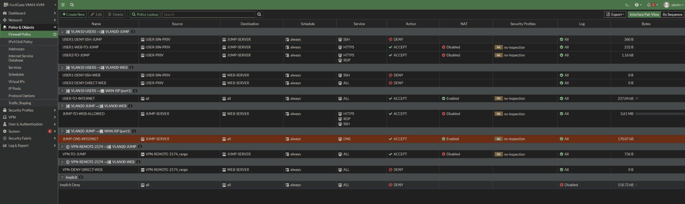

La política del Jump **no utiliza ALL**. Se limita a `HTTPS`, `RDP` y `SSH`; TCP/80 queda bloqueado y fue validado explícitamente.

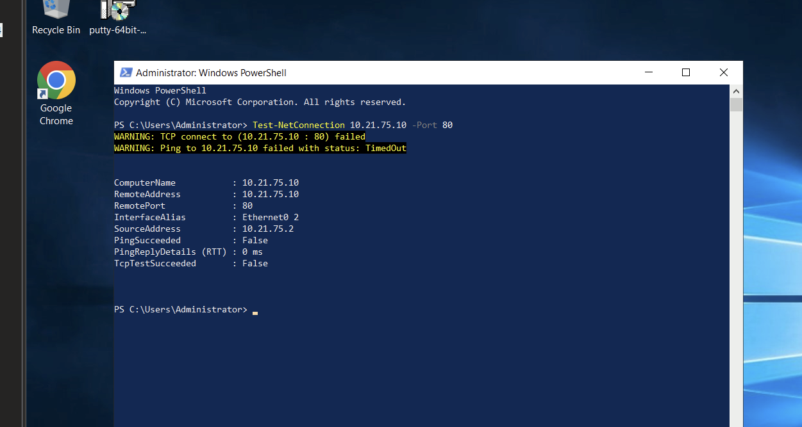

### 5.4 VPN IPsec Remote Access

La VPN `VPN-REMOTE-2174` termina en `port1` (`21.74.3.2`) y utiliza:

- IKEv1 / Aggressive Mode
- PSK + XAUTH
- DES-MD5 / DES-SHA1
- DH Group 5
- Pool `10.212.135.10–10.212.135.20`
- Split tunnel limitado al objeto `JUMP-SERVER`

> **Nota de seguridad:** IKEv1, DES y SHA1 se mantienen únicamente por compatibilidad con el laboratorio. No representan parámetros recomendados para producción.

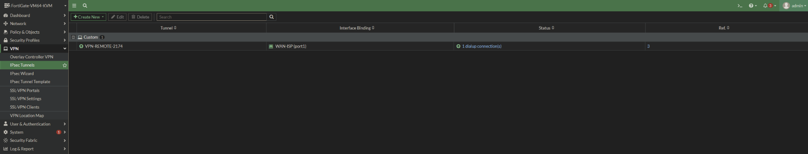

La validación del cliente remoto muestra acceso al Jump y bloqueo directo hacia el Web Server:

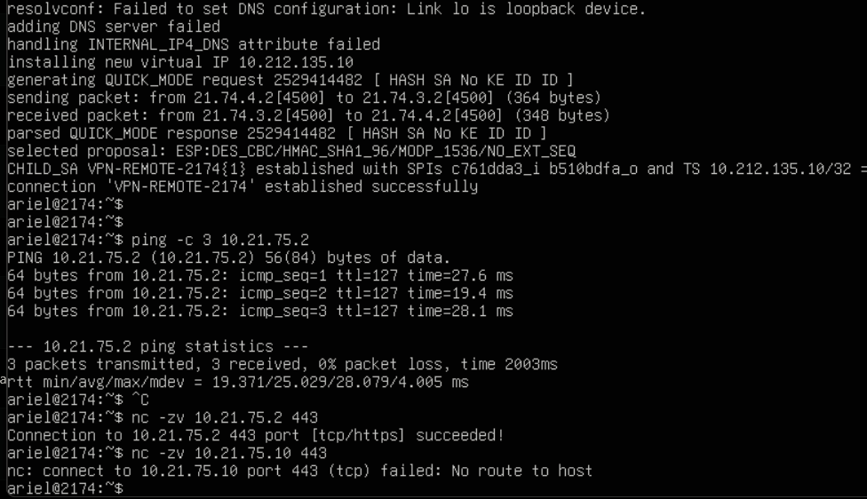

### 5.5 Jump Server y RemoteApp

`JUMP-SERVER-2174` utiliza Windows Server en `10.21.75.2/29` y centraliza las aplicaciones publicadas mediante Remote Desktop Services.

Se configuraron dos perfiles:

- **Sin privilegios:** únicamente el recurso Web.
- **Privilegiado:** Web + PuTTY + Remote Desktop Connection.

#### RD Web Access clásico

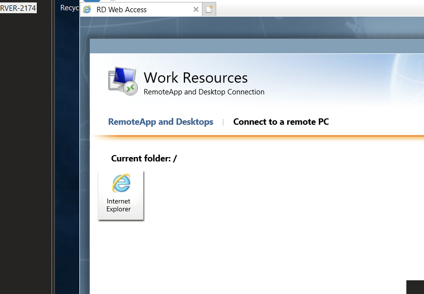

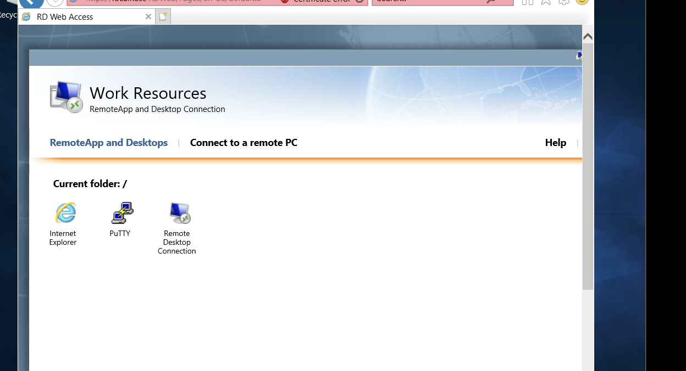

#### Remote Desktop Web Client HTML5

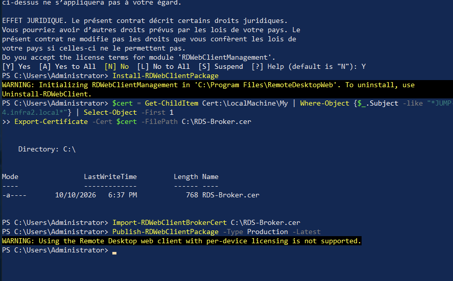

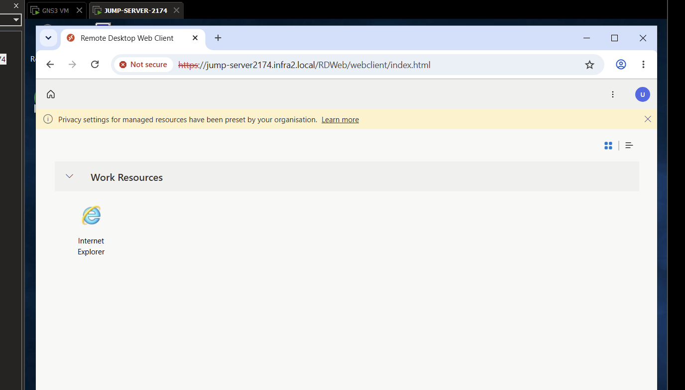

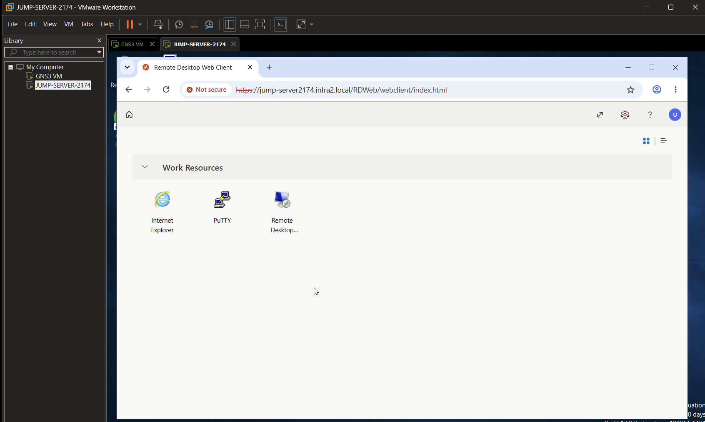

Más detalle: [`docs/rds-remoteapp.md`](docs/rds-remoteapp.md)

### 5.6 Web Server

`WEB-SV-2174` utiliza `10.21.75.10/29` y funciona como servidor del **Sistema de Caja**. Para la validación del laboratorio se utiliza su endpoint Apache HTTPS, junto con:

- HTTPS — TCP/443
- SSH — TCP/22
- XRDP — TCP/3389

La conexión RDP real desde el Jump alcanza el login XRDP del Web Server:

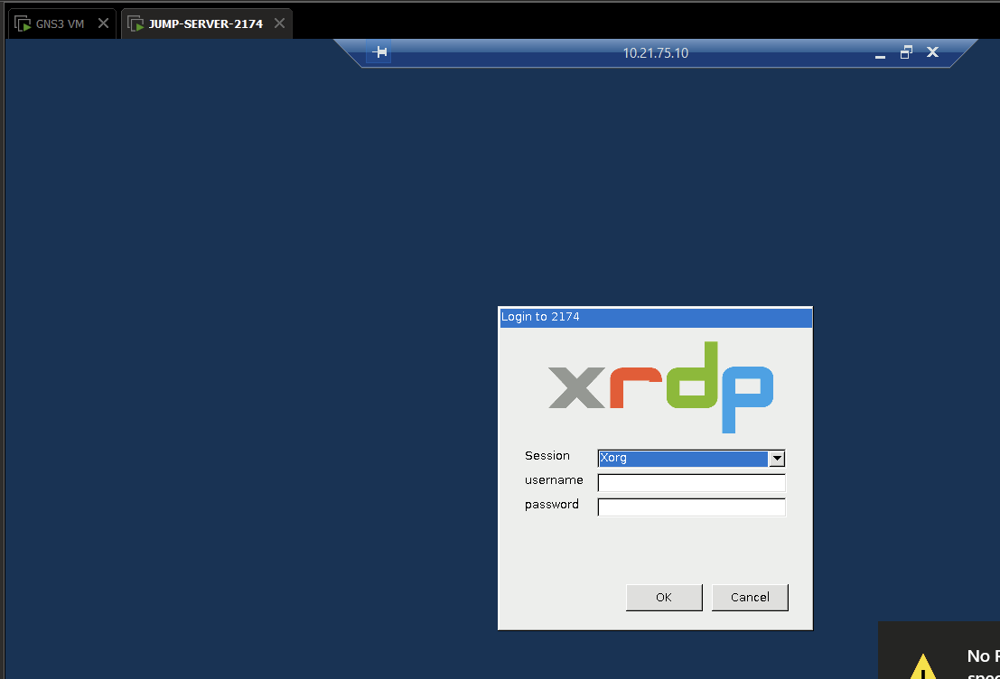

### 5.7 ISP y PAT

`ISP-2174` utiliza:

- `Fa0/0` → DHCP hacia NAT1, `ip nat outside`
- `Fa1/0` → `21.74.3.1/30`, `ip nat inside`
- `Fa1/1` → `21.74.4.1/30`, `ip nat inside`
- PAT → `ip nat inside source list 1 interface FastEthernet0/0 overload`

La configuración final fue depurada retirando una ruta estática heredada que ya no pertenecía a esta infraestructura.

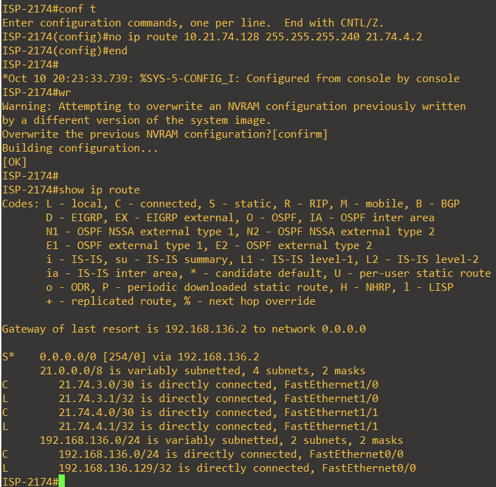

---

## 6. Validación funcional

### 6.1 Usuario sin privilegios

`PC-USER1-2174` recibe `10.21.74.10/25`. HTTPS hacia el Jump funciona, mientras que SSH/RDP directos no establecen sesión.

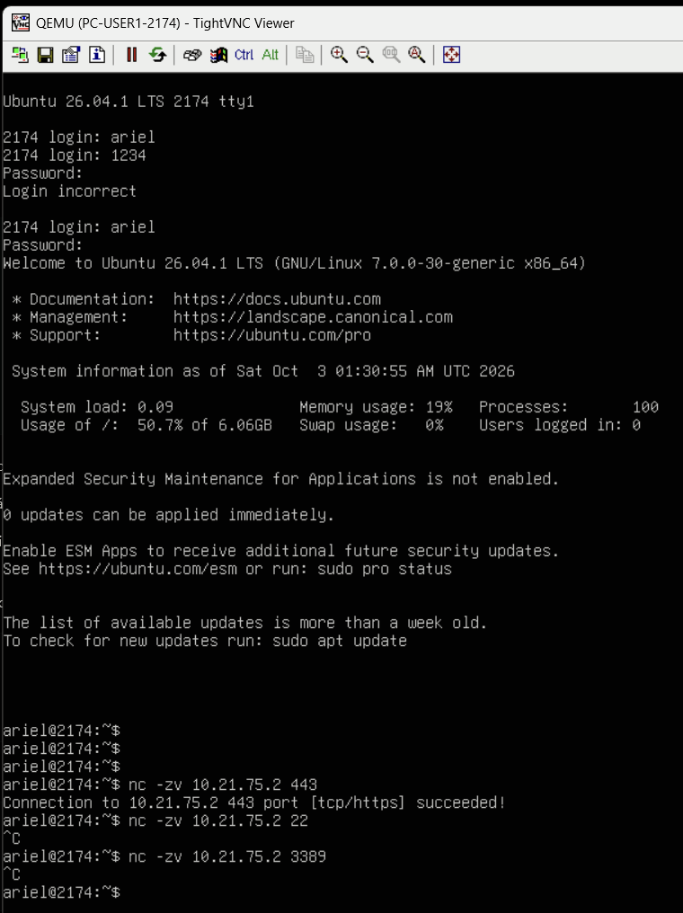

### 6.2 Usuario privilegiado

`PC-USER2-2174` recibe `10.21.74.11/25`. HTTPS y RDP hacia el Jump están disponibles. SSH directo permanece restringido; PuTTY se entrega como RemoteApp.

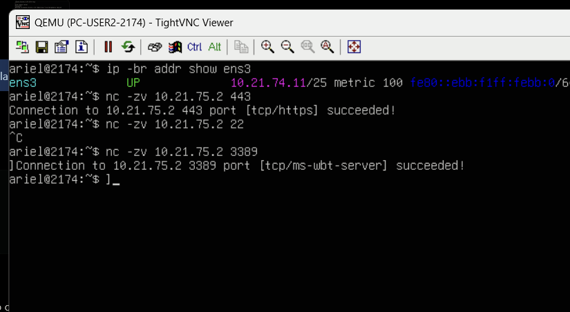

### 6.3 VPN

Al ejecutar:

```bash
sudo ipsec up VPN-REMOTE-2174
```

el cliente recibe `10.212.135.10/32`. Se validó:

```text
VPN -> JUMP 10.21.75.2:443     SUCCESS
VPN -> WEB  10.21.75.10:443    BLOCKED / No route to host
```

### 6.4 Jump hacia Web

Solo se autorizaron los tres servicios requeridos:

```text
TCP/22    SSH    permitido
TCP/443   HTTPS  permitido
TCP/3389  RDP    permitido
TCP/80    HTTP   bloqueado
```

La matriz completa está en [`docs/validacion.md`](docs/validacion.md).

---

## 7. Configuraciones y scripts

### Running-configs

[`running-configs/`](running-configs/) contiene:

- `ISP-2174.txt`
- `SW-INFRA2-2174.txt`
- `FortiGate-2174-relevant.conf`
- `FortiGate-2174-SANITIZED.conf`

### Configuración VPN

[`configs/`](configs/) contiene una plantilla pública de strongSwan y un archivo de secretos con valores reemplazados por `<REDACTED>`.

### Scripts / comandos

[`scripts/`](scripts/) contiene:

- comandos de validación;
- comandos principales de RD Web Client / RemoteApp;
- instalación de XRDP + XFCE en el Web Server.

> **Seguridad del repositorio:** no se publican contraseñas, PSK, llaves privadas ni secretos reales. El backup de FortiGate incluido fue sanitizado.

---

## 8. Estructura del repositorio

```text
SR-PRACTICA-3-INFRAESTRUCTURA-2/
├── README.md
├── configs/
│   ├── README.md
│   ├── VPN-CLIENT-2174-ipsec.conf.example
│   └── ipsec.secrets.example
├── docs/
│   ├── direccionamiento.md
│   ├── rds-remoteapp.md
│   └── validacion.md
├── evidencias/
│   ├── README.md
│   └── 01...16.png
├── running-configs/
│   ├── README.md
│   ├── FortiGate-2174-relevant.conf
│   ├── FortiGate-2174-SANITIZED.conf
│   ├── ISP-2174.txt
│   └── SW-INFRA2-2174.txt
└── scripts/
    ├── README.md
    ├── comandos-validacion.txt
    ├── jump-server-rds-webclient.ps1
    └── web-server-xrdp-setup.sh
```

---

## 9. Estado final

- [x] FortiGate configurado y administrado por GUI
- [x] VLAN10 `/25` con dos usuarios y DHCP
- [x] Jump Server en LAN `/29`
- [x] Web Server en LAN `/29`
- [x] VPN IPsec Remote Access funcional
- [x] VPN limitada al Jump Server
- [x] Jump → Web limitado a HTTPS, RDP y SSH
- [x] Usuario sin privilegios limitado al recurso Web
- [x] Usuario privilegiado con Web + PuTTY + RDP
- [x] RD Web Access clásico
- [x] Remote Desktop Web Client HTML5
- [x] Puertos Cisco no utilizados en VLAN999 + shutdown
- [x] ISP con PAT hacia NAT1
- [x] Running-configs finales guardados
- [x] Evidencias depuradas

---

## 10. Observación de seguridad

Esta práctica reproduce tecnologías y parámetros heredados por compatibilidad de laboratorio. Para un entorno productivo se recomienda utilizar suites criptográficas modernas, certificados emitidos por una CA de confianza, MFA para acceso remoto y políticas de mínimo privilegio más estrictas.
